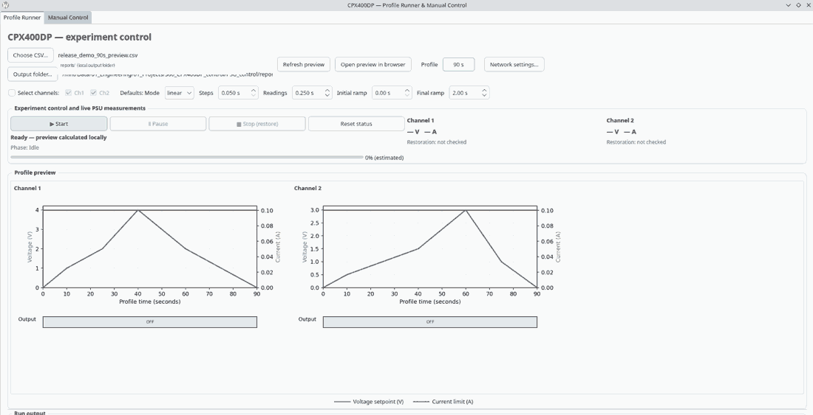
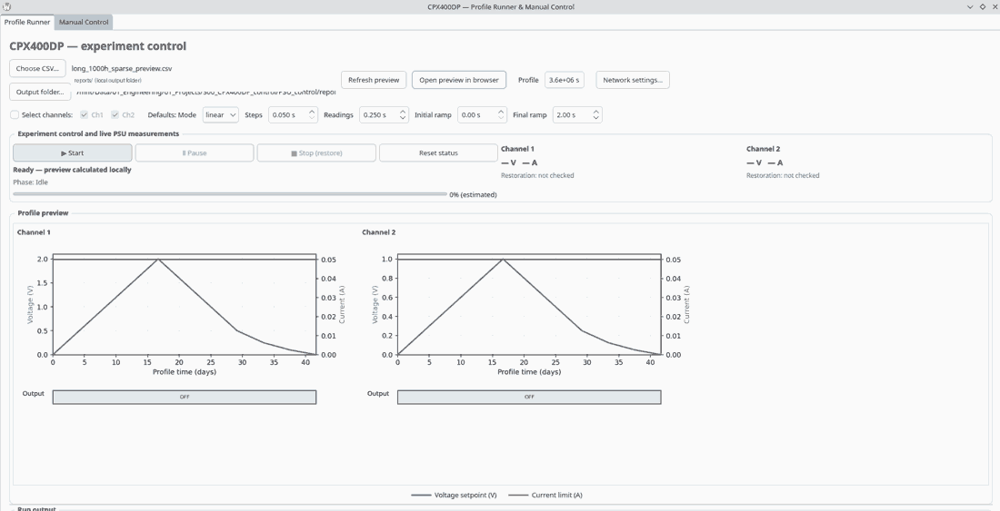
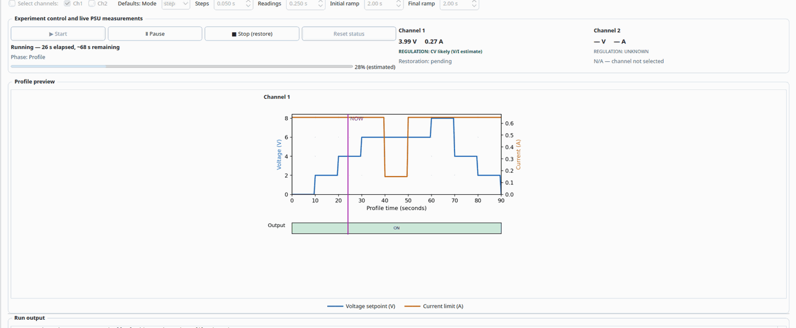
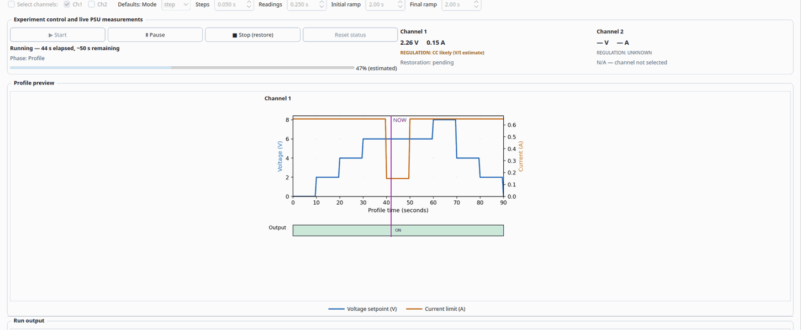
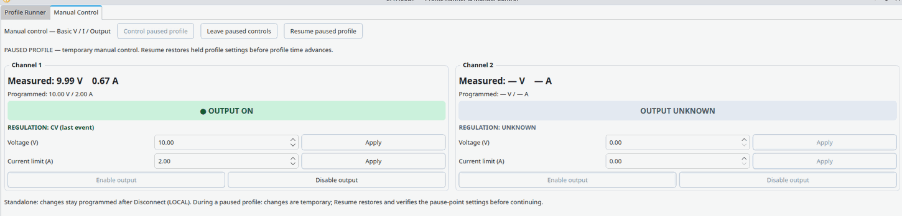
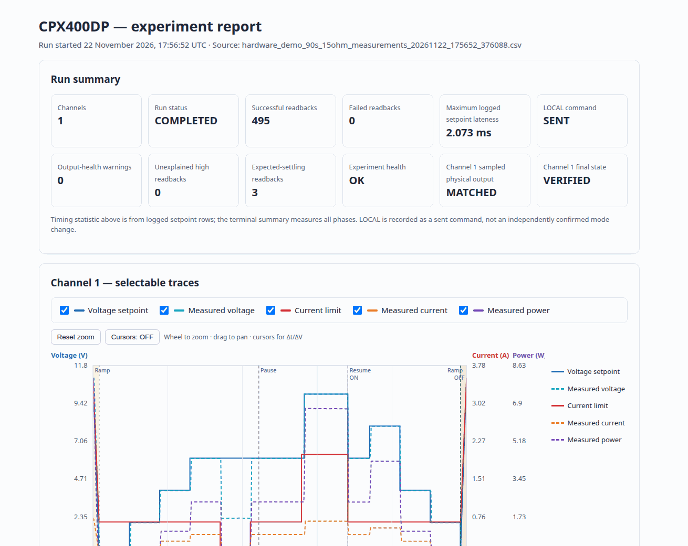
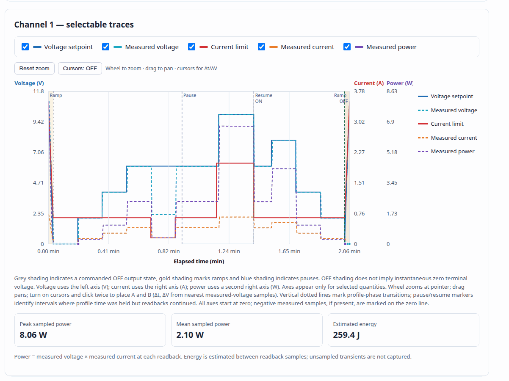

# CPX400DP Control

A Linux desktop application for controlling an **Aim-TTi / Thurlby Thandar CPX400DP** dual-output power supply over Ethernet. Create voltage and current-limit profiles in CSV, preview them, control the PSU manually or from a profile, and inspect recorded measurements in an interactive HTML report.

## Features

- **Profile Runner:** one- or two-channel CSV profiles, step/linear interpolation, output-enable control and configurable ramps and sampling intervals.
- **Manual Control:** program voltage, current limit and output state; pause a profile, make temporary adjustments, then resume.
- **Live feedback:** voltage/current readbacks, estimated CV/CC indication and a moving marker on the profile preview.
- **Reports:** measured voltage, current and power; zoom, pan, cursors, event annotations and recorded experiment summaries.
- **Instrument connection:** identify the PSU using Network settings, and remember the last successfully verified connection.

## In use

The screenshots below are from actual CPX400DP operation. The GUI is also able to preview a profile without connecting to the PSU.

| Preview a two-channel profile | Inspect a long-duration schedule |
|:---:|:---:|
|  |  |
| Inspect both channels' programmed voltage, current limits and output state before running. | The preview supports timelines extending to 1,000 hours without running the experiment. |

| Follow profile progress | Observe current limiting |
|:---:|:---:|
|  |  |
| The magenta **NOW** line follows profile time; voltage/current measurements and a CV estimate appear beside the controls. | In a current-limited stage the measured voltage falls below the programmed setpoint, while the runner displays **CC likely**. |

| Adjust a paused profile | Review a completed experiment |
|:---:|:---:|
|  |  |
| Pause the sequence, adjust voltage/current limit or output state, then resume from the held profile settings. | The HTML report summarises the completed run, readbacks, restoration checks and recorded events. |



*Enable or hide voltage, current and power traces; zoom and use cursors to examine measurements and transitions.*


## Install and launch

Use Python 3 with **PyQt5 or PySide6** and **Matplotlib** on Linux. From a clone of this repository:

```bash
/usr/bin/python3 scripts/install_desktop_launcher.py
```

Search for **CPX400DP Control** in the KDE Plasma Application Launcher, or pin it to the taskbar. No administrator privileges are required for the launcher. To run the application directly:

```bash
/usr/bin/python3 scripts/cpx400dp_gui.py
```

To remove the application-menu shortcut without deleting the project:

```bash
/usr/bin/python3 scripts/install_desktop_launcher.py --uninstall
```

## Connect and run a profile

1. Open **Network settings**, select the PSU's Ethernet connection and use **Test connection** to identify the instrument. The address and network interface depend on your setup; the application remembers the last verified connection.
2. Choose a CSV file, select an output folder, and **Refresh preview** to inspect the setpoints and output-enable sequence. Adjust step/linear mode, update/readback intervals and ramps in the GUI as needed.
3. Press **Start** to run the profile. **Pause** holds the sequence, with optional temporary manual adjustments; **Resume** restores the held profile settings before continuing. **Stop** and normal completion initiate the configured restoration sequence.
4. Open the generated HTML report for measurements, transitions and timing. Existing recordings can also be reviewed without the PSU connected.

## CSV profiles

Profiles are ordinary CSV files containing times in seconds, programmed voltage, current limit and output-enable state. The channel(s) are inferred from the column names; no IP address or configuration preamble is required.

```csv
time_s,ch1_voltage_v,ch1_current_limit_a,ch1_enable
0,0,0.5,1
10,2,0.5,1
20,4,0.5,1
30,0,0.5,0
```

Use `ch2_voltage_v`, `ch2_current_limit_a` and `ch2_enable` as additional columns for the second channel. `1` means output enabled, `0` disabled. The GUI controls interpolation mode, update timing, readback interval and ramp durations. Profiles in [`profiles/examples/`](profiles/examples/) illustrate common shapes:

| Example | Duration | Maximum programmed voltage | Description |
| --- | ---: | ---: | --- |
| [Single-channel profile](profiles/examples/ch1_90s_3v.csv) | 90 s | CH1 3 V | Stepped voltage profile |
| [Current-limit transition](profiles/examples/ch1_90s_8v_cc.csv) | 90 s | CH1 8 V | Includes a reduced current-limit stage for exploring CC/CV response |
| [Two-channel profile](profiles/examples/dual_90s.csv) | 90 s | CH1 4 V / CH2 3 V | Both outputs commanded OFF; useful for previewing |
| [24-hour profile](profiles/examples/ch1_24h.csv) | 24 h | CH1 2 V | Sparse long-duration example |
| [Seven-day profile](profiles/examples/dual_7d.csv) | 7 days | CH1 3 V / CH2 1.5 V | Two-channel long-duration example |
| [1,000-hour profile](profiles/examples/dual_1000h.csv) | 1,000 h | CH1 2 V / CH2 1 V | Extended timeline preview |

These example CSVs contain waveform data only. The **GUI's current settings** determine interpolation mode and timing; the filenames do not impose those settings. For long-duration runs, choose an appropriate update/readback interval rather than relying on the default 50 ms update interval.

## Reports

Each run can generate a CSV measurement record and an HTML report. Reports include selectable voltage/current/power traces, experiment events, zoom and cursors. For large recordings, keep the `*_report_data/` directory beside the corresponding HTML file so detailed traces can load when you zoom in.

To regenerate a report from an existing measurement CSV:

```bash
/usr/bin/python3 scripts/cpx400dp_report.py path/to/measurements.csv
```

## Safety and responsibility

**This software is provided as-is for laboratory use, without warranty or guarantee of suitability for any particular purpose.** The operator is responsible for selecting a suitable load, configuring safe voltage and current limits, assessing operating conditions and monitoring the equipment as appropriate. Automation does not replace the PSU's protections or an independent safety interlock. On normal completion the application attempts to restore the **previous programmed settings, including output ON if it was ON before the run**; restoration does not necessarily mean switching the output OFF. Network failure, PC power loss, exhausted storage or an instrument fault may prevent commands from being delivered or verified. Recorded confirmation is not an independent electrical safety measurement; inspect the instrument after unexpected interruptions.