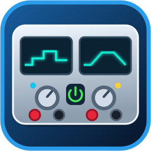

# CPX400DP PSU Control



Linux/Kubuntu desktop tool for controlling a dual-channel
Aim-TTi / Thurlby Thandar CPX400DP power supply over Ethernet:
CSV profile playback, standalone and paused-profile manual control,
offline preview, measured readbacks, and interactive HTML reports.

**Version:** v13.6 (22 November 2026). Validated on real
CPX400DP hardware with supervised 90-second profiles, pause/manual
control, and CV/CC inference. Full Python and Chromium regression
tests run in GitHub Actions. Important: programmed-state restoration
returns the PSU to its **original** settings, including an originally
enabled output; inspect the physical instrument after use.

## Features

- Two-channel CSV profiles with step or linear interpolation,
  output enable control, optional initial/final ramps and saved-state
  restoration; minimum scheduled setpoint spacing 50 ms
- Pausing a run, temporarily changing settings with Manual Control,
  and guarded Resume; Stop requests verified restoration and LOCAL
- Standalone Manual Control with programmed V/I/enable state,
  measurement readbacks and clear output-state indicators
- Profile Runner channel readouts display conservative `CV likely` / `CC likely`
  estimates derived from already logged programmed and measured values;
  UNKNOWN for ambiguous states. These are **not** instrument-verified
  real-time regulation-mode readings. Manual Control's LSR mode labels
  remain explicitly last observed read-and-clear events.
- Read-only PSU discovery/identification in **Network settings…**,
  with last successfully verified host/interface remembered
- Offline previews and dynamic seconds/minutes/hours/days axes;
  lazy scheduling of very long sparse-keyframe profiles;
  **moving magenta NOW marker** tracking estimated live profile position,
  accounting for initial ramp and frozen while paused
- Offline HTML measurement reports with selectable V/I/P traces,
  zoom, pan, cursors and large-log local on-demand detail chunks
- Read-only recording audit and advisory disk-space warnings,
  plus CSV write-failure containment to preserve cleanup attempts

For complete behaviour, limitations and historical findings see
[engineering handover](docs/PROJECT_HANDOVER.md),
[current session state](docs/SESSION_STATE.md), and the
[v13.6 release candidate](docs/RELEASE_CANDIDATE_v13_6.md).

## Installation and launch

The application uses Python 3 on Linux and the Qt GUI binding already
available on the workstation (PyQt5 or PySide6). Offline preview
and report plots require Matplotlib. No internet is needed at runtime.

### KDE Plasma application launcher

From a checkout of this repository, install a normal user-local
application-menu entry and scalable CPX400DP icon:

```bash
/usr/bin/python3 scripts/install_desktop_launcher.py
```

Search **CPX400DP Control** in the KDE Application Launcher.
Right-click it to **Add to Favorites** or **Pin to Task Manager**;
KDE can also add a desktop shortcut. No root privileges or new
dependencies are required. The installer dynamically detects the
checkout directory, uses the same Python interpreter that runs it,
and writes only to your personal XDG application/icon directories.

Preview changes or remove the launcher safely:

```bash
/usr/bin/python3 scripts/install_desktop_launcher.py --dry-run
/usr/bin/python3 scripts/install_desktop_launcher.py --uninstall
```

If you move the repository, rerun the installer to update its
absolute launch path. Installing the launcher **never runs the PSU
or changes its network settings**.

### Direct launch without an icon

```bash
/usr/bin/python3 scripts/cpx400dp_gui.py
```

In the GUI, choose a CSV profile, select a folder for generated reports
(e.g. `reports/`), preview it, and open **Network settings…** to
enter the instrument IPv4 address/interface if needed. **Test connection**
performs read-only `*IDN?` identification and closes its test socket.
Only pressing Start or connecting Manual Control establishes a
control session. The runner takes a verified initial snapshot before
changing programmed settings, attempts configured final restoration,
and sends `LOCAL` as its last instrument command.

On the validated dual-instrument bench the PSU uses
`192.168.71.2` over the dedicated Dell D6000 Ethernet adapter.
Another workstation will have different addresses and interface names;
do not copy or overwrite other networking configurations. The earlier
link-local discovery and opt-in adapter setup remain available but are
not necessary for the already-configured static bench link.

## Example CSV profiles

| File | Duration | Purpose |
| --- | --- | --- |
| [Release GUI screenshot preview](profiles/examples/release_demo_90s_preview.csv) | 90 s | Two-channel step plot; both outputs commanded OFF; offline screenshot fixture |
| [24-hour step preview](profiles/examples/long_24h_step_preview.csv) | 24 h | Five sparse keyframes; output OFF |
| [Seven-day linear preview](profiles/examples/long_7d_linear_preview.csv) | 7 days | Eight dual-channel keyframes; outputs OFF |
| [1,000-hour step preview](profiles/examples/long_1000h_sparse_preview.csv) | 1,000 h | Eleven dual-channel keyframes; outputs OFF |
| [Optional supervised live demo](profiles/examples/hardware_demo_90s_REQUIRES_LOAD.csv) | 90 s | CH1 up to 3 V with a 0.10 A current limit; **REQUIRES an appropriate resistive load** |
| [15 Ω, 10 W load demo](profiles/examples/hardware_demo_90s_15ohm_REQUIRES_LOAD.csv) | 90 s | CH1 up to 8 V (~4.27 W at 15 Ω), with a 10-second 0.15 A current-limiting interval; supervised test only |

For a **15 Ω resistor rated 10 W continuous**, the revised live example
peaks at 8 V, equivalent to about 0.533 A and 4.27 W; the 40–50 s
interval requests 6 V with a 0.15 A limit and can illustrate CC operation.
Review the GUI's effective application defaults and the PSU's original
programmed state before running. This remains a supervised example,
not a hardware interlock or a guarantee about other loads.

All preview fixtures are for inspecting time axes and waveforms
**without running the PSU**. Their requested OFF state is not permission
for unattended hardware operation. The live demo needs a bench safety
check and must be supervised. See
[the short hardware acceptance checklist](docs/HARDWARE_ACCEPTANCE_v13_6.md).

Generate a 1,000-hour offline preview:

```bash
/usr/bin/python3 scripts/cpx400dp_run_enhanced.py \
  --preview profiles/examples/long_1000h_sparse_preview.csv
```

A synthetic 1,000-hour measurement CSV with a brief artificial peak
is available in the supplementary examples bundle supplied during
development; it is **fictional**, never a real PSU hardware run.

## Reports and recording checks

For CSV logs smaller than 8 MiB, the report is a self-contained HTML
file. Larger logs generate an HTML report **plus a matching
`*_report_data/` directory**, containing per-channel data chunks
loaded as the browser zooms in. Keep the folder beside its report HTML;
preserve the original measurement CSV as the authoritative source.

To generate a report from a recording:

```bash
/usr/bin/python3 scripts/cpx400dp_report.py reports/example_measurements.csv
```

The report generator needs no connection to the PSU. For an audit
of existing logs (including interrupted runs):

```bash
/usr/bin/python3 scripts/cpx400dp_recording_audit.py reports
```

Audits classify the **recorded** final-state and LOCAL events, not
actual electrical output or front-panel LOCAL confirmation.

To archive an experiment **after it has finished**, without deleting
anything or omitting large-report sidecars:

```bash
/usr/bin/python3 scripts/cpx400dp_archive.py reports/example_measurements.csv
```

The archive includes a checksum manifest, refuses to overwrite an
existing ZIP and retains the original files. It is opt-in only.
Consult [storage and recovery limitations](docs/RECORDING_RECOVERY.md)
and [large-report details](docs/REPORT_STREAMING.md).

## Offline regression

```bash
PYTHONPATH=scripts /usr/bin/python3 -m unittest discover -s tests -p 'test_*.py'
```

GitHub Actions additionally runs the full Python suite and an isolated
headless Chromium browser test for a synthetic long report. Browser
testing is performed in CI; the user does not need to install
Playwright locally.

## Release screenshots

Seven **real hardware/UI screenshots** from 22 November 2026
were supplied and reviewed, showing the 90-second preview,
1,000-hour offline preview, paused Manual Control, completed
run, HTML charts and diagnostic summary. A privacy-cropped
PNG bundle has been prepared, but the files **have not yet been
committed to GitHub**. README galleries will be linked once
the actual PNG assets exist under `docs/screenshots/`.
See [hardware acceptance details](docs/HARDWARE_ACCEPTANCE_v13_6.md).

The screenshot preview used GUI application defaults in
**linear mode** even though example CSV metadata requests
step mode. The paused-profile screenshot also shows a
manual current limit of 1.00 A rather than the original
example's 0.10 A. Neither should be misrepresented in
captions.

## Version history and development records

| Version | Status |
| --- | --- |
| v13.3 | [Historical release notes](docs/RELEASE_v13_3.md) |
| v13.4 | [Historical release notes](docs/RELEASE_v13_4.md) |
| v13.5 | Previous stable milestone; see [historical release](docs/RELEASE_v13_5.md) |
| v13.6 | Released 22 Nov 2026; see [release notes](docs/RELEASE_v13_6.md), [evidence](docs/RELEASE_CANDIDATE_v13_6.md) and [backlog](docs/BACKLOG.md) |

The development process maintains two documents:
`docs/PROJECT_HANDOVER.md` for durable design/safety knowledge and
`docs/SESSION_STATE.md` for actual changes, validation evidence and next steps.

**Safety:** this is laboratory automation, not a hardware interlock.
A sudden PC power loss, network disconnection, full disk or PSU fault
can leave outputs in an unknown state. Never infer safe terminal
conditions solely from CSV log events, and always inspect the real
instrument after an unexpected interruption. Do not run extended
experiments unattended without a separately engineered safety plan.
